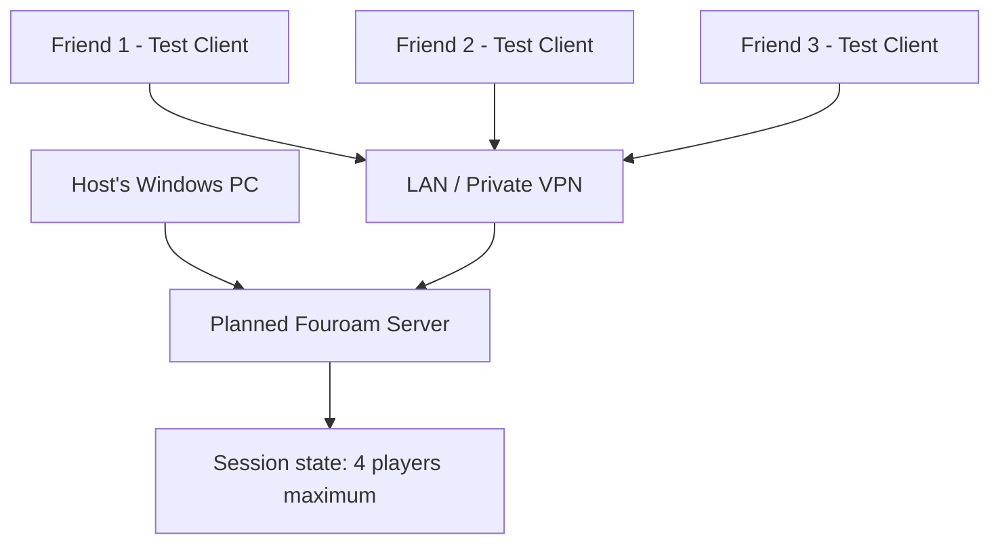

# Architecture Proposal

> This document describes a future design, **not working code**.

## Network topology

The host computer should be able to run the server and participate as a player. Three additional clients connect using a local or private VPN address. A VPS is optional, never mandatory.

## Proposed modules

| Module | Responsibility |
| --- | --- |
| Host process | Start, configure and stop the server |
| Connection manager | Accept, validate and remove peers |
| Session manager | Assign identifiers and enforce capacity |
| Shared protocol | Define bounded, typed and versioned messages |
| Test client | Test connections without launching GTA V |
| State replication | Coordinate shared state in a standalone simulation |
| Game integration | Feasibility and authorization research only |

## Initial design principles

- Prototype independently of GTA V.
- Begin with TCP connection and lifecycle handling.
- Treat each remote peer and message as untrusted.
- Keep a host-authoritative model.
- Handle disconnects and timeouts predictably.
- Avoid mandatory accounts, cloud backend, telemetry and sensitive logs.

## Open technical questions

- Which game-side integrations, if any, are permitted?
- Which Windows and GTA V editions could be supported?
- What data needs reliable delivery versus low-latency delivery?
- How should host migration and reconnection work?
- What is the right boundary between server and game-side client?

Official story missions and platform achievements are **not committed features**.
